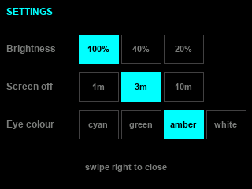
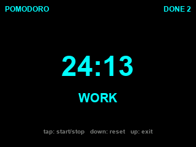
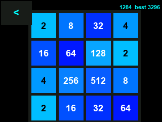

# cyd-eyes

Expressive animated eyes on a Cheap Yellow Display, plus a small photo viewer, 2048
and a pomodoro timer. The eyes follow your finger, blink, get drowsy when ignored and
shut happily when you stroke the gap between them.

Target board: **ESP32-2432S028R** ("CYD"), 2.8" 320x240, resistive touch, microSD,
RGB LED, LDR. No speaker, so every reaction is visual.

## What it does

- Eleven expressions drawn procedurally from a parameter table, no bitmaps.
- Gaze tracks the finger; slow drags only move the eyes.
- Idle chain: dazed at 45 s, sleepy at 2 min with occasional yawns, asleep at 3 min
  exactly when the backlight cuts.
- Backlight: full, 23% after 15 s, off after 3 min. Touch wakes it instantly.
- Frame budget follows the state: 40 fps in use, 25 when dimmed, 0 when dark.
- Random JPEG from `/cyd` on the SD card, decoded from RAM into the panel.
- 2048 on a 4x4 board, 32 bytes of state, tap the `<` button or hold still to leave.
- Pomodoro 25/5 using `millis()`; no RTC needed.
- Settings screen for brightness, screen-off timeout and eye colour, stored in NVS.

## Screens

| | |
|---|---|
|  |  |
|  |  |

These are drawings produced by `tools/make_previews.py` from the same coordinates,
colours and font sizes as the firmware, not camera photographs of the panel.

## Gestures

| Screen | Action | Result |
|---|---|---|
| Eyes | tap | blink |
| Eyes | swipe up >= 90 px and >= 675 px/s | random photo |
| Eyes | swipe right >= 160 px and >= 520 px/s | 2048 |
| Eyes | swipe down >= 90 px and >= 675 px/s | pomodoro |
| Eyes | swipe left >= 160 px and >= 520 px/s | settings |
| Eyes | slow drag | gaze only |
| Photo | up / down | next photo / back to eyes |
| 2048 | any of four, >= 60 px | move |
| 2048 | tap `<`, or hold 1.5 s | back to eyes |
| Pomodoro | tap / down / up | start-stop / reset / back |
| Settings | tap button / swipe right | change / back |

Speed gates apply only on the eye screen, where a gesture competes with steering the
gaze. Modal screens use distance alone.

## Build and flash

```bash
pio run -e cyd -t upload        # firmware
pio run -e cyd_probe -t upload  # hardware probe: colour bars, LED, LDR
```

The USB socket on this board drops off the bus mid-upload, so flashing is usually done
through the retry helper:

```powershell
powershell -ExecutionPolicy Bypass -File tools\flash_retry.ps1 -Env cyd -Attempts 6
```

An aborted upload leaves a half-written image behind; flash again rather than
debugging the symptom.

## Photos

Photos stay out of the repository. Put JPEGs anywhere and point the sender at them:

```powershell
$env:CYD_PHOTOS = 'D:\photos-cyd'
python tools\send_photos.py COM3
```

The script crops to 4:3, shrinks in two steps to 320x240 and encodes JPEG q92 with
**4:4:4** chroma, because 4:2:0 smears small detail. Files are pushed over the serial
line into `/cyd` on the card: this laptop has no SD reader, and the firmware accepts
`PUT <name> <bytes>` followed by raw data.

## Measured on this board

| Item | Value |
|---|---|
| Panel | ILI9341, needs `-DTFT_INVERSION_ON=1`; without it every colour inverts |
| Touch | XPT2046 bit-banged on 25/32/33/36/39, calibration X 360-1700, Y 320-1670 |
| Touch edges | readings clamp to coordinate 0 near the bezel; hit areas must include 0 |
| LDR | dark means a HIGH reading (light gives 0) |
| Static RAM | 26.8 KB of 320 KB |
| Flash | 422 KB of 3 MB |
| Frame rate | 36-38 fps on the eye screen |

Two library quirks worth remembering: `SD.exists()` reports the filesystem as
unmounted on this core, so the JPEG decoder is fed an in-memory buffer instead of a
path; and handing the decoder an open `File` draws part of the image and then abandons
it, which looks like flicker.

## Layout

```
src/          eyes_main.cpp, board.h, probe_main.cpp
lib/eye       expression engine
lib/touch     XPT2046 bit-bang driver with calibration
lib/gallery   JPEG viewer reading /cyd
lib/game2048  2048
lib/pomodoro  25/5 timer
lib/settings  brightness, timeout, eye colour (NVS)
lib/uploader  serial file receiver and debug commands
lib/pet       unused: the earlier stats-based pet, kept for later
tools/        flash retry, photo sender, serial logger
```

## Not done

- OTA over WiFi was built and removed: the board sits on a different subnet than the
  PC, so cable flashing remains the supported path.
- The 2048 best score lives in RAM only.
- No audio until an 8 ohm speaker is wired to the P4 connector.

## License

MIT, see `LICENSE`.
